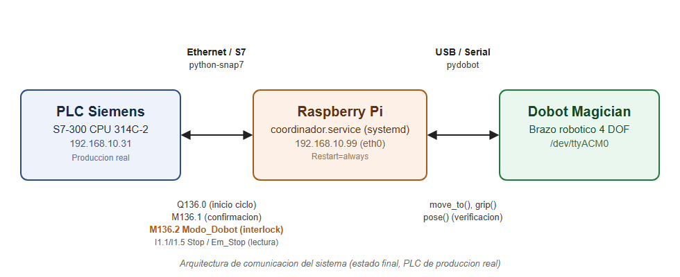

# Readaptación de software libre sobre un sistema heredado cerrado
### Integración de un Dobot Magician Lite con un PLC Siemens S7-300 para inspección de calidad por visión

Este repositorio documenta la integración de un brazo robótico de bajo costo (Dobot Magician
Lite) y una Raspberry Pi, usando exclusivamente software libre (Python, OpenCV, python-snap7),
sobre la celda didáctica Festo MPS "Separating", controlada por un PLC Siemens S7-300 cerrado y
propietario. El sistema agrega inspección de calidad por visión artificial que el mecanismo
neumático original no tenía, **sin modificar el programa de control certificado del PLC más
allá de un único bloque de interlock mínimo y acotado (`FC130`)**.

Proyecto de graduación (TFG), Tecnológico de Costa Rica, Sede San Carlos.

Este manual está escrito para que alguien que **nunca ha usado ninguno de estos equipos** (PLC,
Dobot, Raspberry Pi) pueda tanto replicar el montaje desde cero como operarlo y mantenerlo
después, sin que el autor original esté presente. No reexplica el código ni la lógica del PLC
paso a paso — esos ya están escritos y documentados; este manual dice qué cargar, dónde, en qué
orden, y qué hacer si algo deja de funcionar (ver especialmente [Operación
diaria](#operación-diaria) y [Mañas](#mañas-troubleshooting-operativo)). Para el diseño y el
razonamiento detrás de cada decisión, ver el informe de tesis completo (Capítulos 5 y 6).

## Por qué este enfoque

Muchas plantas industriales operan con PLCs y celdas de varios años o décadas de antigüedad,
con presupuesto limitado para reemplazar el sistema de control completo. Este proyecto
demuestra un patrón replicable: **leer y escribir directamente la memoria del PLC por red
(protocolo S7, vía `python-snap7`), usando un puñado de bits como interlock**, en vez de abrir,
modificar o volver a cargar el programa completo del autómata. Toda la lógica nueva (visión,
decisión de descarte, comunicación con el robot) vive completamente afuera, en una Raspberry Pi
barata.

Esto se valida cuantitativamente con una comparación de OEE (Overall Equipment Effectiveness)
contra el mecanismo original — ver [Resultados](#resultados-de-validación).

## Qué hace el sistema, en resumen

Cuando una tapa llega al punto de separación de la celda, el PLC avisa a la Raspberry Pi que hay
una pieza lista. La Raspberry Pi toma una foto con la cámara montada en el Dobot, decide si la
pieza está en buen estado o tiene un defecto, y mueve el brazo para colocarla en la línea (si
está bien) o desviarla a un punto de descarte aparte (si no). Al terminar, la Pi le confirma al
PLC que la tarea se completó, y el ciclo se repite con la siguiente pieza. Mientras el Dobot está
activo, el PLC bloquea el mecanismo neumático original para que los dos nunca operen a la vez
sobre la misma pieza.

## Arquitectura



El puente entre el PLC y el Dobot es la Raspberry Pi, que cumple dos roles simultáneos:
- **Cliente S7** (`python-snap7`) hacia el PLC, leyendo/escribiendo bits de memoria específicos.
- **Host USB** del Dobot (`pydobot`) y de una cámara USB para la inspección por visión.

### Direcciones del PLC usadas (interlock)

| Dirección | Tipo | Quién escribe | Significado |
|---|---|---|---|
| `I0.0` (Part_AV) | Entrada, solo lectura | PLC (sensor físico) | Pieza presente en el punto de recogida |
| `I0.1`-`I0.5` (B2-B6) | Entrada, solo lectura | PLC (sensores físicos) | Sensores de la banda, usados para diagnóstico |
| `I1.1`/`I1.5` (NC) | Entrada, solo lectura | PLC (botones físicos de la cadena de seguridad de la estación) | 0 = presionado |
| `M136.2` (`Modo_Dobot`) | Marca interna, lectura y escritura | Ambos | Interlock central: mientras está en `True`, el PLC le cede el control de la pieza al Dobot |
| `Q136.0` | Salida, solo lectura (desde la Pi) | PLC (`FC130`) | "Hay una tarea lista para el Dobot" |
| `M136.1` | Marca interna, escritura | Pi (pulso breve) | Confirmación de "tarea completada" |
| `Q0.1` (banda de descarte) | Salida, escritura | Pi | Mueve la pieza rechazada fuera del punto de descarte (identificada por observación externa, no estaba documentada) |

### Modificación al programa del PLC: bloque `FC130`

A diferencia de lo que podría sugerir "no se tocó el PLC", **sí se agregó un bloque nuevo
(`FC130`, "P_Dobot") en TIA Portal**, con doce redes que implementan una máquina de estados de
tres pasos (D2 → D3 → D4). También se agregaron dos redes nuevas en `OB1`: un contacto NC de
`Modo_Dobot` que bloquea la llamada a la lógica neumática original (`FC120`) mientras el Dobot
está activo, y la llamada incondicional a `FC130`. El resto del programa original del PLC
permanece sin cambios.

**Este manual no reconstruye la lógica Ladder red por red** — las doce redes de `FC130` y las dos
redes nuevas de `OB1`, ya programadas y con cada dirección documentada, están en
[`docs/fc130/`](docs/fc130/) (capturas de TIA Portal) y explicadas con más detalle en el
Capítulo 5 del informe de tesis. El proyecto completo de TIA Portal, con `FC130` y las dos redes
de `OB1` ya incluidas, está comprimido en [`docs/Separating_LIVE.zip`](docs/Separating_LIVE.zip)
— para dejar el PLC funcionando, basta con descomprimirlo, abrirlo en TIA Portal y descargarlo al
PLC real. Si se prefiere reconstruirlo desde cero sobre otro proyecto base: crear el bloque
`FC130` (lenguaje KOP) y reproducir ahí las doce redes mostradas en esas capturas, agregar las dos
redes nuevas en `OB1`, compilar y descargar al PLC.

**El resto de la integración — visión, decisión de aceptar/rechazar, movimiento del robot,
calibración — vive enteramente en [`src/coordinador.py`](src/coordinador.py), sin ningún otro
cambio al programa del PLC.** Ese archivo se usa tal cual está en este repositorio (ver
[Instalación](#instalación)); no hay que reescribirlo.

## Requisitos de hardware

- Dobot Magician Lite + AI Camera Kit (cámara USB 2.0 de 1 MP incluida, se monta sobre el
  efector del brazo). Manuales oficiales del fabricante incluidos en
  [`docs/dobot_lite_manual.pdf`](docs/dobot_lite_manual.pdf) y
  [`docs/dobot_std_manual.pdf`](docs/dobot_std_manual.pdf).
- Raspberry Pi (probado en Pi 3) con Raspberry Pi OS, tarjeta microSD (mínimo 8 GB), y una fuente
  de alimentación robusta — la Raspberry Pi 3 usada en este proyecto tiene un problema de
  alimentación conocido que se agrava con el consumo simultáneo del Dobot y la cámara por USB.
- PLC Siemens S7-300 (o cualquiera de la familia S7 compatible con `python-snap7`) con módulo de
  comunicación Ethernet/PROFINET, en la misma red que la Pi, con el programa base de la celda
  Festo MPS "Separating" ya cargado.
- Cable Ethernet (Pi ↔ PLC) y cable USB estándar (Pi ↔ Dobot).
- Canasta y seis columnas de soporte impresas en 3D en PETG (archivos listos para imprimir en
  [`docs/cad/`](docs/cad/): `canasta.stl` y `columna.stl`; también está el editable
  `canasta.f3d` de Fusion 360 — no hay un `.f3d` editable equivalente para la columna, solo el
  `.stl` final; las cotas completas están en el Capítulo 5 del informe de tesis), con un mínimo
  de 3-4 perímetros sólidos y relleno de al menos 40 % en las zonas estructurales.
- Tornillería M5 (ocho tornillos para fijar las columnas a los rieles de la celda, más seis para
  fijar la canasta a las columnas).

## Montaje físico

1. **Imprimir las piezas.** Una canasta (`docs/cad/canasta.stl`) y seis columnas
   (`docs/cad/columna.stl` × 6), en PETG, con los parámetros de impresión indicados arriba.
2. **Fijar las columnas a los rieles de la celda.** Cada columna tiene una abrazadera en su
   extremo inferior que se atornilla al riel con dos tornillos M5. Van tres columnas por riel: una
   en cada esquina y una en el punto medio, para un total de seis.
3. **Atornillar la canasta sobre las columnas.** El piso de la canasta tiene ocho huecos de
   holgura para M5 (dos columnas de cuatro, una por riel); se usan seis de los ocho —tres por
   riel, alineados con las columnas ya fijadas— y quedan dos libres.
4. **Montar el Dobot Magician dentro de la canasta**, encajando su base en el hueco interior, con
   el cableado y el botón de encendido orientados hacia el lado abierto de la canasta.
5. **Montar la cámara del AI Camera Kit** sobre el efector del Dobot, siguiendo las instrucciones
   incluidas con el kit.

## Red y cableado

1. Conectar el Dobot a la Raspberry Pi con el cable USB incluido con el equipo.
2. Conectar la cámara del AI Camera Kit a un puerto USB libre de la Raspberry Pi.
3. Conectar la Raspberry Pi al puerto Ethernet/PROFINET del PLC mediante un cable de red directo
   (no se requiere ningún módulo de interfaz adicional entre ambos).
4. Energizar la Raspberry Pi con una fuente adecuada (ver nota de alimentación arriba).

## Instalación

### 1. Preparar la Raspberry Pi desde cero

1. Grabar Raspberry Pi OS en la microSD con [Raspberry Pi
   Imager](https://www.raspberrypi.com/software/). En las opciones avanzadas del Imager (ícono de
   engranaje), **antes de grabar**: habilitar SSH (con usuario y contraseña), y configurar el
   nombre de usuario que se va a usar.
2. Insertar la microSD en la Raspberry Pi y energizarla con la Ethernet ya conectada (al PLC o,
   para esta primera configuración, a la misma red que la computadora desde donde se va a
   conectar por SSH).
3. Conectarse por SSH desde otra computadora: `ssh usuario@raspberrypi.local` (o la IP que haya
   recibido por DHCP, visible en el router o con un escáner de red).
4. Configurar una IP estática en la interfaz Ethernet (`eth0`), dentro de la misma subred que el
   PLC (en este proyecto, PLC en `192.168.10.31/24` y Pi en `192.168.10.99/24`), usando
   `NetworkManager`:
   ```bash
   nmcli con show                       # anotar el nombre exacto de la conexión cableada
   sudo nmcli con mod "<nombre>" ipv4.addresses 192.168.10.99/24
   sudo nmcli con mod "<nombre>" ipv4.method manual
   sudo nmcli con up "<nombre>"
   ```
   (Ajustar la IP según la subred real del PLC a conectar; debe ser una dirección libre y distinta
   a la del PLC.)

### 2. Descargar este repositorio en la Raspberry Pi

```bash
git clone https://github.com/DiegoReyes29/dobot-plc-readaptacion.git
cd dobot-plc-readaptacion
```

### 3. Instalar dependencias

```bash
# Dependencias del sistema (OpenCV vía apt, NO vía pip - ver "Mañas" abajo)
sudo apt install python3-opencv libopenblas0

# Entorno virtual de Python
python3 -m venv dobot_env
source dobot_env/bin/activate
pip install pydobot python-snap7 'numpy<2'

# Symlink de opencv del sistema hacia el venv (apt lo instala fuera del venv)
ln -s /usr/lib/python3/dist-packages/cv2*.so dobot_env/lib/python3.*/site-packages/
```

### 4. Regla de udev para la cámara (nombre fijo, no índice numérico)

El índice `/dev/videoN` que Linux asigna a la cámara puede cambiar cada vez que se
desconecta/reconecta físicamente. Para evitarlo:

```bash
# /etc/udev/rules.d/99-camara-dobot.rules
SUBSYSTEM=="video4linux", ATTRS{idVendor}=="058f", ATTRS{idProduct}=="3841", ENV{ID_V4L_CAPABILITIES}=="*:capture:*", SYMLINK+="camara_dobot"
```

```bash
sudo udevadm control --reload-rules && sudo udevadm trigger
```

El `idVendor`/`idProduct` corresponde a la cámara del AI Camera Kit (Alcor Micro, Corp.) — para
otra cámara, obtené los valores con `lsusb` o revisando `dmesg` tras conectarla.

### 5. Regla de udev para el Dobot (mismo problema, mismo fix)

El mismo problema de la cámara aplica al Dobot: `/dev/ttyACM0` puede pasar a ser `/dev/ttyACM1`
según el orden en que Linux enumera los dispositivos USB tras un power-cycle — lo que deja
`coordinador.service` en bucle de reintentos (`Restart=always` cada 5 s) sin conectar nunca, sin
ningún mensaje obvio para quien no tenga una computadora a mano para revisar el log. Mismo fix,
symlink fijo por `idVendor:idProduct`:

```bash
# /etc/udev/rules.d/99-dobot-magician.rules
SUBSYSTEM=="tty", ATTRS{idVendor}=="f055", ATTRS{idProduct}=="9800", SYMLINK+="dobot_magician"
```

```bash
sudo udevadm control --reload-rules && sudo udevadm trigger
```

El Dobot Magician Lite se presenta ante Linux como un puerto serial virtual MicroPython
(`f055:9800`), no como un dispositivo "Dobot" con nombre propio — confirmado con `lsusb` con el
Dobot conectado. `coordinador.py` usa `/dev/dobot_magician` como `DOBOT_PORT` en vez del índice
numérico, igual que con la cámara.

### 6. Calibrar las posiciones del Dobot y el PLC (ver secciones siguientes)

Antes de arrancar el servicio en producción, hay que ajustar en `src/coordinador.py` las
coordenadas del Dobot (`PICK`, `PLACE`, `WAYPOINT_1-3`, `HOME`, `DESCARTE`) y, si el PLC es
distinto al usado en este proyecto, `PLC_IP`, `RACK` y `SLOT` — ver
[Calibración de las posiciones del Dobot](#calibración-de-las-posiciones-del-dobot).

### 7. Servicio systemd (arranque automático y recuperación ante fallos)

```ini
# /etc/systemd/system/coordinador.service
[Unit]
Description=Coordinador Dobot - PLC Separating
After=network-online.target

[Service]
ExecStart=/home/pi/dobot_control/dobot-plc-readaptacion/dobot_env/bin/python3 /home/pi/dobot_control/dobot-plc-readaptacion/src/coordinador.py
Restart=always
RestartSec=5
Environment=PYTHONUNBUFFERED=1
StandardOutput=append:/home/pi/coordinador.log

[Install]
WantedBy=multi-user.target
```

(Ajustar las rutas de `ExecStart` a donde haya quedado clonado el repositorio y creado el
entorno virtual.)

```bash
sudo systemctl enable --now coordinador.service
```

## Calibración de las posiciones del Dobot

Las coordenadas `PICK`, `PLACE`, `DESCARTE`, `WAYPOINT_1-3` y `HOME` en `src/coordinador.py` son
específicas de la posición física exacta del montaje — hay que calibrarlas la primera vez que se
monta el sistema, y recalibrarlas si el Dobot se desmonta, se golpea, o se cambia de celda.

1. Con el Dobot ya montado y conectado por USB (y `coordinador.service` **detenido**, para que el
   puerto serial quede libre — ver nota en [Mañas](#mañas-troubleshooting-operativo)), correr la
   utilidad incluida en este repositorio:
   ```bash
   python3 src/leer_pose.py
   ```
   Este script no mueve el brazo ni escribe nada al PLC: solo lee e imprime la posición actual del
   Dobot (`x, y, z, r`) varias veces por segundo.
2. Mover el brazo a mano hasta la posición deseada (el punto de recogida de la pieza, el punto de
   colocación en la línea, el punto de descarte, la posición de espera, y los puntos intermedios
   de la trayectoria que evitan los obstáculos de la celda) y anotar los valores que muestra el
   script en ese instante para cada punto.
3. Reemplazar los valores de `PICK`, `PLACE`, `WAYPOINT_1`, `WAYPOINT_2`, `WAYPOINT_3`, `HOME` y
   `DESCARTE` en `src/coordinador.py` con las coordenadas anotadas.
4. Verificar con ciclos de prueba (ver [Primera puesta en marcha](#primera-puesta-en-marcha)) que
   la trayectoria completa no choca contra ningún elemento de la celda antes de dejar el sistema
   en producción.

## Calibración de visión

La detección de pieza combina **forma** (Hough Circle Transform sobre un ROI recortado) y
**color** (distancia HSV promedio dentro de una máscara anular, más porcentaje de píxeles en un
rango de color de marca de defecto). Esta sección explica cómo se obtiene cada número, para que
se pueda repetir con una pieza, cámara o iluminación distintas.

### 1. Región de interés (ROI) y detección de forma

`RX, RY, RW, RH` en `src/coordinador.py` recortan la zona de la imagen donde cae la pieza en el
punto de `PICK` (no se analiza la imagen completa: el fondo metálico de la celda genera decenas
de contornos falsos). Para obtenerlos: tomar una foto de referencia con la pieza en `PICK`, y
recortar a mano (en cualquier editor de imágenes) hasta que el recuadro contenga solo la pieza
con un margen razonable — esos píxeles de esquina son `RX, RY, RW, RH`.

Dentro de ese recorte, `cv2.HoughCircles` busca el círculo del collar de la pieza:

```python
circles = cv2.HoughCircles(
    gray, cv2.HOUGH_GRADIENT, dp=1.2, minDist=100,
    param1=80, param2=40, minRadius=30, maxRadius=68
)
```

`minRadius`/`maxRadius` se ajustan a ojo: se corre sobre varias fotos de referencia y se achica o
agranda el rango hasta que detecte consistentemente el círculo real de la pieza y no, por
ejemplo, un círculo falso sobre un objeto vecino (en este proyecto pasó con el brazo de
Distributing de fondo — hubo que bajar `maxRadius` para dejar de engancharlo).

### 2. Referencia de color

Una vez detectado el círculo (centro `x,y` y radio `r`), se construye una **máscara anular**
(entre 45&nbsp;% y 90&nbsp;% del radio) para medir el color: esto evita el agujero central de la
pieza y el borde exterior, donde el enfoque es peor. El color de referencia es el promedio HSV
de los píxeles dentro de esa máscara, en una foto de una pieza buena conocida — **nunca
muestrear con una caja de coordenadas fija**, porque si la pieza no cae exactamente en el mismo
píxel que el día de la calibración anterior, el resultado no es representativo; siempre hay que
re-detectar el círculo primero y medir dentro de esa máscara.

`COLOR_REFS_HSV` es una **lista** de referencias, no una sola, porque la luz ambiente cambia a
lo largo del día (se verificó una deriva real de Saturación de ~34 a ~20 entre la mañana y el
atardecer en una misma sesión) y una sola referencia fija no alcanza. Un valor se acepta si
coincide con **cualquiera** de las referencias de la lista, dentro de `TOLERANCIA_HSV`.

### 3. Criterio de marca de defecto (segundo criterio, independiente del color promedio)

El promedio de color de toda la pieza no detecta bien defectos chicos o localizados (una marca
pequeña mueve poco el promedio). Por eso hay un segundo criterio, en paralelo (unido por OR, no
reemplaza al primero): el **porcentaje de píxeles dentro de la máscara anular que caen en un
rango de color de defecto** (`AZUL_LOWER`/`AZUL_UPPER`, calibrado para marcador azul — ajustar el
rango HSV al color de defecto real que se quiera detectar). Si ese porcentaje supera
`UMBRAL_PCT_AZUL`, se rechaza, sin importar qué tan cerca esté el promedio general del color de
referencia.

### 4. Procedimiento para recalibrar

1. Juntar fotos de piezas buenas y de cada tipo de defecto que se quiera detectar, sin tocar el
   PLC ni el Dobot (por ejemplo, guardando una copia de las fotos que `coordinador.py` ya
   almacena en `~/fotos_evaluadas` durante la operación normal).
2. Medir el color de cada una con el mismo método de detección por círculo + máscara anular que
   usa `evaluar_pieza()` en `src/coordinador.py` (nunca a mano con una caja fija).
3. Si las piezas buenas caen en un color distinto a las referencias existentes, **agregar** una
   referencia nueva a la lista (no reemplazar las anteriores — pueden seguir siendo válidas bajo
   otra luz).
4. Validar el criterio completo (color promedio OR % de defecto) contra TODAS las muestras
   conocidas, buenas y malas, antes de desplegar — un cambio de calibración que no se valida así
   puede arreglar un falso positivo y crear uno nuevo en otro lado.

## Primera puesta en marcha

Antes de dejar el sistema corriendo sin supervisión, verificar en este orden:

1. Con `coordinador.service` detenido, correr `python3 src/leer_pose.py` y confirmar que la
   Raspberry Pi se comunica con el Dobot (si no conecta, revisar el cableado USB y la regla de
   udev del Dobot).
2. Con el PLC en modo RUN y `Modo_Dobot` en falso, confirmar que la lógica neumática original
   sigue funcionando sin cambios (el interlock no debe bloquearla mientras el Dobot está inactivo).
3. Arrancar `coordinador.service` y, con una sola pieza, verificar un ciclo completo: que el PLC
   active `Q136.0`, que el Dobot recoja y coloque la pieza sin chocar contra ningún elemento de la
   celda, y que `M136.1` se active al terminar.
4. Repetir con una pieza con un defecto conocido y confirmar que se desvía al punto de descarte en
   vez de colocarse en la línea.
5. Dejar correr varios ciclos consecutivos sin intervención manual antes de considerar el montaje
   terminado.

## Operación diaria

Esta sección es para alguien que tenga que mantener el sistema funcionando sin haber participado
en el montaje — resume lo mínimo para operarlo día a día sin tener que leer el resto del manual.

### Iniciar, detener y revisar el estado

```bash
sudo systemctl status coordinador.service   # ¿está corriendo? ¿se reinició solo hace poco?
sudo systemctl start coordinador.service    # iniciarlo
sudo systemctl stop coordinador.service     # detenerlo (por ejemplo, para calibrar)
sudo systemctl restart coordinador.service  # reiniciarlo
```

Con `Restart=always` configurado (ver [Instalación](#instalación)), el sistema arranca solo al
energizar la Raspberry Pi y se reinicia solo si el script se cae por cualquier razón — en
operación normal no debería ser necesario tocar estos comandos.

### Ver qué está haciendo el sistema ahora mismo

```bash
tail -f /home/pi/coordinador.log
```

Cada ciclo (pieza recogida, resultado de la inspección, pieza colocada o desviada a descarte)
queda registrado ahí con su hora. `Ctrl+C` para dejar de ver el log sin detener el servicio.

También queda una copia de cada foto evaluada, aprobada o rechazada, en `~/fotos_evaluadas`, útil
para revisar después por qué el sistema rechazó o aprobó una pieza en particular.

### Señales de que algo anda mal (sin tener que leer el log completo)

| Síntoma | Causa probable | Qué hacer |
|---|---|---|
| El Dobot no se mueve, las piezas se acumulan en el punto de recogida | `coordinador.service` no está corriendo, o no logra conectar al Dobot/PLC | `sudo systemctl status coordinador.service`; revisar el log con `tail` |
| El Dobot se mueve pero rechaza piezas buenas | La cámara no está detectando correctamente (luz distinta, cámara desconectada al arrancar) | Ver [Mañas](#mañas-troubleshooting-operativo); puede necesitar recalibración de color (ver [Calibración de visión](#calibración-de-visión)) |
| El Dobot choca o se detiene a medio movimiento | Alguna coordenada quedó mal calibrada (el montaje se movió, se golpeó el brazo) | Detener el servicio y recalibrar (ver [Calibración de las posiciones del Dobot](#calibración-de-las-posiciones-del-dobot)) |
| El sistema deja de responder y no se reinicia solo | Falla más profunda (hardware, puerto serial atascado) | Reiniciar la Raspberry Pi físicamente (apagar y volver a energizar) |
| Se necesita volver al mecanismo neumático original | — | Forzar `Modo_Dobot` a falso desde TIA Portal, o simplemente detener `coordinador.service`: el interlock libera la estación automáticamente por el watchdog de 30 s si la Pi deja de responder |

Para cualquier problema que no esté en esta tabla, la sección [Mañas](#mañas-troubleshooting-operativo)
cubre los casos conocidos con más detalle, y el informe de tesis completo (Capítulos 5 y 6)
documenta el diseño completo del sistema para diagnósticos más a fondo.

## Mañas (troubleshooting operativo)

### Por diseño, no hay que "arreglarlas"
- El watchdog de 30 s de `FC130` y la recuperación de ~16-20 s de `systemd` tras una apertura de
  la cadena de seguridad o un reinicio son capas de seguridad intencionales.
- **Nunca correr un script aparte que abra el puerto serial del Dobot** mientras
  `coordinador.service` está corriendo — un puerto serial solo admite un dueño a la vez; causa
  desincronización y lecturas de pose corruptas. Esto incluye `src/leer_pose.py`: hay que detener
  el servicio primero (`sudo systemctl stop coordinador.service`) antes de correrlo, y reiniciarlo
  después (`sudo systemctl start coordinador.service`).
- **La cámara debe estar conectada antes de arrancar `coordinador.py`** (o antes de reiniciar
  `coordinador.service`) — la cámara se abre una única vez al inicio del script y no se
  redetecta en caliente durante la sesión. Si se conecta después de que el servicio ya está
  corriendo, el sistema sigue funcionando pero sin visión (todas las piezas se tratan como
  aprobadas) hasta el siguiente `sudo systemctl restart coordinador.service`. El symlink fijo
  `/dev/camara_dobot` (regla de udev por `idVendor:idProduct`, no por índice) sí es independiente
  del puerto USB usado — confirmado conectándola en un puerto distinto al habitual.

### Limitación de fondo (librería/hardware, no hay fix de raíz)
- **Bug de desincronización serial de `pydobot`** (lecturas de pose corruptas, errores
  intermitentes de I/O): se captura como excepción y se trata como movimiento fallido, no tumba
  el proceso — pero el bug en sí es de la librería upstream.
- Las coordenadas de movimiento son absolutas, no autocorregidas por visión — si se mueve el
  brazo físicamente, hay que recalibrar a mano.

## Resultados de validación

Comparación de OEE contra el mecanismo neumático original, con datos reales de 120 piezas
procesadas en dos corridas comparables de 30 piezas por sistema (incluyendo defectos reales
insertados a propósito):

| | Eléctrico y neumático | Dobot + visión |
|---|---|---|
| **Calidad** (detección de defectos) | 10 % | 100 % |
| **Rendimiento** (throughput real, eléctrico y neumático = base) | 100 % | 72.6 % |
| **Disponibilidad** | 100 % | 100 % |
| **OEE** | **10 %** | **72.6 %** |

Ver el informe de tesis completo para la metodología detallada, las corridas individuales, y el
análisis de por qué el mecanismo neumático no detecta este tipo de defecto mientras la visión sí.

## Estructura del repositorio

```
.
├── README.md                      <- este archivo
├── src/
│   ├── coordinador.py             <- script principal, corre como servicio en la Raspberry Pi
│   └── leer_pose.py               <- utilidad de calibración (lee la pose del Dobot)
└── docs/
    ├── diagrama_arquitectura.png
    ├── diagrama_flujo_coordinador.png
    ├── dobot_lite_manual.pdf       <- manual oficial del fabricante, Dobot Magician Lite
    ├── dobot_std_manual.pdf        <- manual oficial del fabricante, Dobot Magician estándar
    ├── Separating_LIVE.zip         <- proyecto completo de TIA Portal (con FC130 y OB1 ya incluidos)
    ├── cad/
    │   ├── canasta.stl             <- pieza imprimible en 3D
    │   ├── canasta.f3d             <- editable, Fusion 360
    │   └── columna.stl             <- pieza imprimible en 3D (imprimir 6)
    └── fc130/
        ├── fc130_red1.png … fc130_red12.png   <- las doce redes del bloque FC130
        ├── ob1_interlock_fc120.png            <- red de OB1 que bloquea la lógica neumática
        └── ob1_llamada_fc130.png              <- red de OB1 que llama a FC130
```
